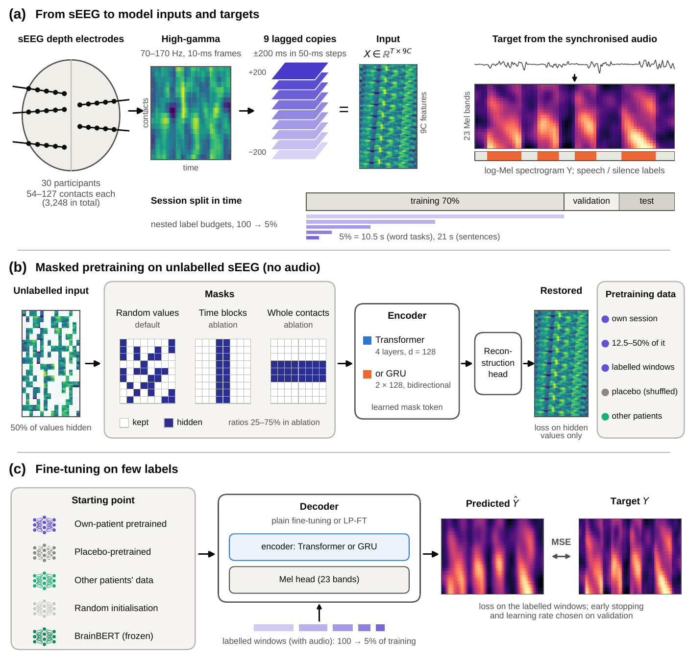

# How much labelled speech does a new patient need?

**Self-supervised pretraining within and across patients for stereo-EEG speech decoding**

[](https://www.python.org/)
[](https://pytorch.org/)
[](LICENSE)
[](https://osf.io/ak3dp/)

Code, pre-specified design documents, analysis scripts and per-run results for the article

> M S Al-Radhi, Ş Cengizli, S Memon and M Verwoert. *How much labelled speech does a new patient need?
> Self-supervised pretraining within and across patients for stereo-EEG speech decoding.*
> Submitted to the *Journal of Neural Engineering* (2026).

Speech decoders for stereo-electroencephalography (sEEG) must be calibrated anew for every patient, from the
little labelled speech that a clinical monitoring session provides. The study asks whether self-supervised
pretraining on the patient's own unlabelled recordings, or on other patients' data, reduces the labelled speech
needed, and what the decoders capture. The repository contains the code to rerun the study from the raw data,
and the results from which every figure, table and statistical test of the article can be recomputed.

<p align="center">
  
</p>

## Main findings

In 30 participants performing three overt speech tasks, with label budgets from a median of 10.5 s to 419 s of
labelled recording:

1. Masked pretraining on the patient's own unlabelled data improved the Transformer at every label budget and the
   bidirectional GRU at 50% to 5% labels, and beat placebo pretraining. For the Transformer it was worth about
   1.5 times the labels.
2. Pretraining on the labelled windows alone gave the Transformer 63% to 95% of this gain, so little or no extra
   recording is needed.
3. Pooled and leave-one-out pretraining across patients, and a six times larger population model, never beat
   own-patient pretraining; frozen features of the foundation model BrainBERT trailed it by 0.10 to 0.31 in
   correlation.
4. A reference that knew only when the participant spoke correlated better with the true spectrogram than every
   decoder.
5. Within speech, the decoders captured loudness more than spectral shape and produced no intelligible audio,
   yet identified the spoken segment above chance.

## What the study does

| | |
|---|---|
| **Data** | 30 participants with sEEG, 3,248 intracranial contacts; unique words, repeated words and sentences (10 participants each) |
| **Input** | High-gamma envelope (70–170 Hz) of every contact in 10-ms frames, with nine lagged copies over ±200 ms |
| **Target** | 23-band log-Mel spectrogram of the synchronised audio |
| **Splits** | Chronological 70 / 15 / 15% training / validation / test; features extracted within each partition |
| **Label budgets** | Nested subsets of 100, 50, 25, 10 and 5% of the training partition |
| **Decoders** | Transformer (4 layers, d = 128) and bidirectional GRU (2 × 128); ridge regression; BrainBERT features with GRU and ridge readouts |
| **Pretraining** | Masked reconstruction of 50% of the input values: on the patient's own session, part of it, or only the labelled windows; a placebo with every feature shuffled in time; pooled, leave-one-out and number-of-patients variants on other patients' data |
| **Fine-tuning** | MSE loss, AdamW, equal step budget at every label budget, early stopping, learning rate chosen on validation from seven values; plain fine-tuning or linear probing then fine-tuning (LP-FT) |
| **Evaluation** | Overall and within-speech correlation with circular-shift chance levels, loudness vs spectral shape, mel-cepstral distortion, ESTOI and STOI, speech-timing reference, identification of the spoken segment, acoustic-contamination audit |
| **Statistics** | Participant-level paired Wilcoxon tests, Holm correction, bootstrap confidence intervals, Page trend tests, non-inferiority test; every hypothesis written down before its stage was run |
| **Scale** | 109,418 training runs on NVIDIA A100 GPUs |

## Repository structure

```
seeg-speech-ssl/
├── src/ieegssl/          the Python package
│   ├── config.py           all settings (overridden per stage by configs/*.json)
│   ├── osf.py              dataset download from OSF
│   ├── preprocessing.py    contact selection, partitioning, high-gamma and log-Mel features
│   ├── data.py             lag stacking, nested label subsets, windows
│   ├── models.py           Transformer and GRU encoders, Mel head, multi-patient model
│   ├── masking.py          random, time-block, contact and all-lag masks
│   ├── train.py            pretraining and fine-tuning protocols (incl. LP-FT)
│   ├── baselines.py        ridge regression and PCA references
│   ├── multi.py            pretraining on other patients' data
│   ├── brainbert.py        BrainBERT encoder and feature extraction
│   ├── metrics.py          correlations, MCD, chance levels
│   ├── evaluation.py       evaluation suite (loudness/shape, resynthesis, ESTOI/STOI)
│   ├── identification.py   identification of the spoken segment
│   ├── contamination.py    acoustic-contamination audit
│   ├── provenance.py       code and configuration hashes written into every result
│   └── runner*.py          one runner per stage
├── scripts/              numbered entry points (download, preprocess, run each stage, collect)
├── configs/              one JSON configuration per stage, plus smoke-test configurations
├── slurm/                SLURM job scripts and environment set-up
├── analysis/             pre-specified statistics of every stage, and run_all.sh
├── docs/                 design documents of the six stages, and the guide to running the study
├── paper/
│   ├── figures/          Figures 1–6 of the article
│   ├── tables/           Table 2 of the article
│   └── supplement/       result tables of the supplementary material
├── results/
│   ├── stats/            statistical outputs used in the article (JSON)
│   └── analysis_outputs.zip  per-run results, evaluation and identification outputs of every stage
├── tests/                fast synthetic unit tests (no data needed)
├── vendor/pystoi/        pystoi 0.4.1 (MIT), bundled for STOI and ESTOI
├── requirements.txt
├── CITATION.cff
└── LICENSE
```

## Installation

Python 3.9 or newer.

```bash
git clone https://github.com/malradhi/seeg-speech-ssl.git
cd seeg-speech-ssl
python -m venv .venv && source .venv/bin/activate      # or a conda environment
python -m pip install -r requirements.txt
```

For training on a GPU, install the PyTorch build that matches your CUDA version first
(see [pytorch.org](https://pytorch.org/get-started/locally/)). The scripts add `src/` to the Python path
themselves, so no package installation is needed.

Tested with: Python 3.9.19, PyTorch 2.4.1 (CUDA 12.4), NumPy 1.26.3 and SciPy 1.13.1 for training; Python 3.13
with pandas 3.0, statsmodels 0.15 and matplotlib 3.11 for the analyses and figures. The figures use the Liberation
Sans font (`fonts-liberation` on Debian/Ubuntu); matplotlib falls back to its default font if it is missing.

## Data

The study uses the openly available dataset of Verwoert *et al.* on OSF, project
[`ak3dp`](https://osf.io/ak3dp/) (about 10 GB). It is not included in this repository;
`scripts/01_download_osf.py` downloads it. Participants P01–P10 are those of the earlier single-word dataset.

- M Verwoert *et al.* (2025). Moving beyond the motor cortex: a brain-wide evaluation of target locations for
  intracranial speech neuroprostheses. *Cell Reports* 44, 116241.
  [doi:10.1016/j.celrep.2025.116241](https://doi.org/10.1016/j.celrep.2025.116241)
- M Verwoert *et al.* (2022). Dataset of speech production in intracranial electroencephalography.
  *Scientific Data* 9, 434. [doi:10.1038/s41597-022-01542-9](https://doi.org/10.1038/s41597-022-01542-9)

## Reproducing the figures, tables and statistics (no GPU)

The per-run results of all 109,418 training runs, the evaluation and identification outputs, and the
statistical outputs are released in [`results/`](results/README.md). From them, every figure, table and test of
the article can be recomputed on a laptop in a few minutes (the statistics take about a minute).

```bash
unzip results/analysis_outputs.zip -d results/            # the phase*_bundle folders

# Figures 1-6  ->  paper/figures/out/
cd paper/figures
python make_figures.py ../../results out
python make_fig1.py out
cd ../..

# Table 2, and the result tables of the supplementary material (S3-S22)  ->  paper/supplement/tables/
python paper/tables/make_table2.py results/stats
cd paper/supplement && sh build.sh && cd ../..

# Every pre-specified statistical test, recomputed from the per-run results  ->  results/stats_rerun/
sh analysis/run_all.sh
```

The recomputed statistics are identical to those in `results/stats/`, which the figures and tables use.

## Running the full study from the raw data

The full study needs a GPU cluster: each stage runs one job per participant (up to about 75 minutes on an A100),
and the whole study comprises 109,418 training runs. [`docs/RUNNING_THE_STUDY.md`](docs/RUNNING_THE_STUDY.md) gives every
step for a SLURM cluster, from the download to the collected result bundles. In short:

```bash
source slurm/env.sh                          # set IEEG_ROOT (and SBATCH_ACCOUNT) there first
python scripts/00_check_env.py               # environment check
python scripts/01_download_osf.py            # dataset from OSF
sbatch slurm/preprocess_fast.sbatch          # features of the 30 participants
python scripts/03_audit.py                   # data audit (3,248 contacts)
sbatch slurm/phase1.sbatch                   # Phase 1, then Phases 2-5 as in the guide
python scripts/20_collect.py --phase phase1  # result bundle of a stage
```

Without SLURM, each stage can be run per participant directly, e.g.
`python scripts/10_run_phase1.py --array-index 1 --config configs/phase1.json`, and
`configs/smoke*.json` give tiny configurations that check the whole pipeline in minutes.

## Stages and pre-specified hypotheses

The study was run in six stages. Before each stage was run, its hypotheses, co-primary measures (overall r and
within-speech r), tests and decision rules were written into a design document in [`docs/`](docs/).

| Stage | Question | Runs | Design |
|---|---|---:|---|
| Phase 1 | Does own-patient masked pretraining beat supervised training and placebo pretraining? Ridge and PCA references; speech-timing reference | 13,230 | [PHASE1_DESIGN.md](docs/PHASE1_DESIGN.md) |
| Phase 2 | Pretraining on other patients' data (pooled, 5/15/30 patients, leave-one-out with adaptation); masking ablation; frozen-encoder readouts; contamination audit | 33,845 | [PHASE2_DESIGN.md](docs/PHASE2_DESIGN.md) |
| Phase 3 | Pretraining for the bidirectional GRU; a six times larger pooled model; learning-rate edges; evaluation suite | 18,963 | [PHASE3_DESIGN.md](docs/PHASE3_DESIGN.md) |
| Phase 4 | BrainBERT baseline; amount of unlabelled data; LP-FT; anatomy | 21,270 | [PHASE4_DESIGN.md](docs/PHASE4_DESIGN.md) |
| Phase 4b | Self-pretraining on the labelled windows only; seven learning rates for every decoder; BrainBERT with 16–64 components per contact | 22,110 | [PHASE4B_DESIGN.md](docs/PHASE4B_DESIGN.md) |
| Phase 5 | Identification of the spoken segment from the decoded spectrograms (CPU, saved predictions) | – | [PHASE5_DESIGN.md](docs/PHASE5_DESIGN.md) |
| **Total** | | **109,418** | |

The statistics of each stage are in [`analysis/`](analysis/README.md); the supplementary material of the article
lists every hypothesis with its outcome.

## Provenance and reproducibility

- Every run writes one JSON file with its metrics, training curves, selected learning rate and the SHA-256 hashes
  of the code (`src/` and `scripts/`) and of the resolved configuration; the result tables list both hashes for
  every run.
- Five seeds per condition (three for some comparisons, as stated in the article). For a given seed, the
  supervised, pretrained and placebo decoders share the same labelled subset, Mel-head initialisation and
  minibatch order, so that only the encoder initialisation differs.
- Learning rates, early stopping and every other choice use the validation partition only; test scores are
  never used to select anything.
- The code grew stage by stage (each stage added its runner), so the code hash differs between stages. This
  release is the final version of the code. For the release, only comments, printed messages and the version
  string were edited, without any change to the computations, so the hash it reports differs from those recorded
  in the result files.

## Tests

```bash
python -m pytest -q tests        # 32 tests, about a minute on a CPU; no data needed
```

The tests check the scientific invariants on synthetic data: partitioning in silences, nested label subsets,
lag stacking, masks, equal step budgets, the linear baselines, the metrics and the BrainBERT front end.

## Citation

If you use this code or the released results, please cite the article (details will be updated on publication):

```bibtex
@article{AlRadhi2026seeg,
  author  = {Al-Radhi, Mohammed Salah and Cengizli, {\c{S}}evval and Memon, Saifullah and Verwoert, Maxime},
  title   = {How much labelled speech does a new patient need? Self-supervised pretraining within and across
             patients for stereo-{EEG} speech decoding},
  journal = {Journal of Neural Engineering},
  year    = {2026},
  note    = {Submitted}
}
```

and the dataset (Verwoert *et al.*, 2025, above). GitHub also offers a citation from [`CITATION.cff`](CITATION.cff).

## Licence and third-party code

The code in this repository is released under the [MIT licence](LICENSE).

- `vendor/pystoi/`: [pystoi](https://github.com/mpariente/pystoi) 0.4.1, MIT licence, copied unchanged
  (see `vendor/pystoi/LICENSE`).
- `src/ieegssl/brainbert.py` re-implements the BrainBERT encoder (Wang *et al.*, ICLR 2023) following the
  [braindecode](https://braindecode.org) port (BSD-3-Clause). The pretrained weights are not redistributed;
  `scripts/04_download_brainbert.py` downloads them from
  [huggingface.co/braindecode/brainbert-pretrained](https://huggingface.co/braindecode/brainbert-pretrained).
- The dataset is not part of this repository and remains under the terms given on OSF.

## Acknowledgements

We acknowledge the Digital Government Development and Project Management Ltd. for awarding us access to the
Komondor HPC facility based in Hungary. We thank the participants, who made their recordings available for
research.

## Contact

Questions and problems: please open an [issue](../../issues). Corresponding authors: Mohammed Salah Al-Radhi
(Budapest University of Technology and Economics) and Maxime Verwoert (Maastricht University).
